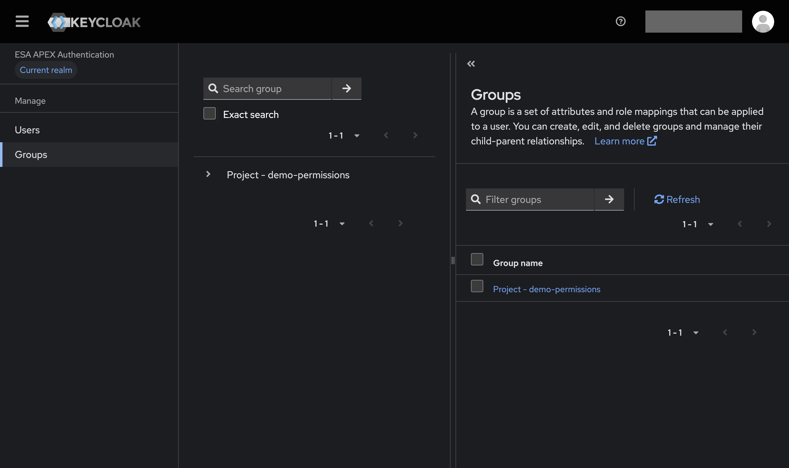
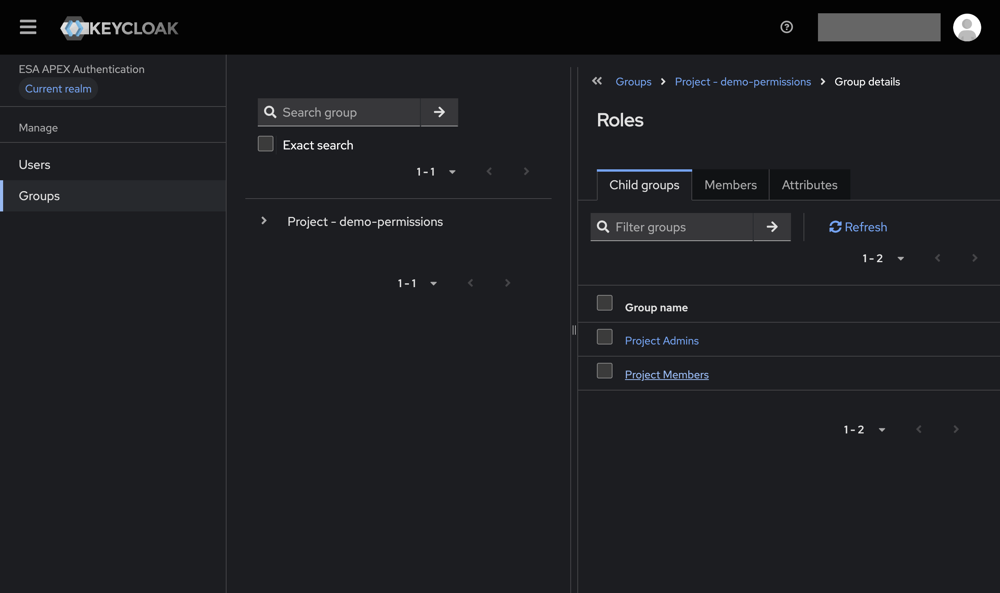
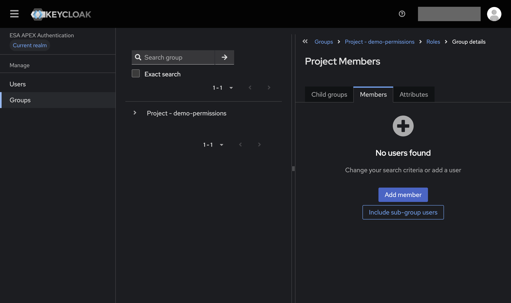
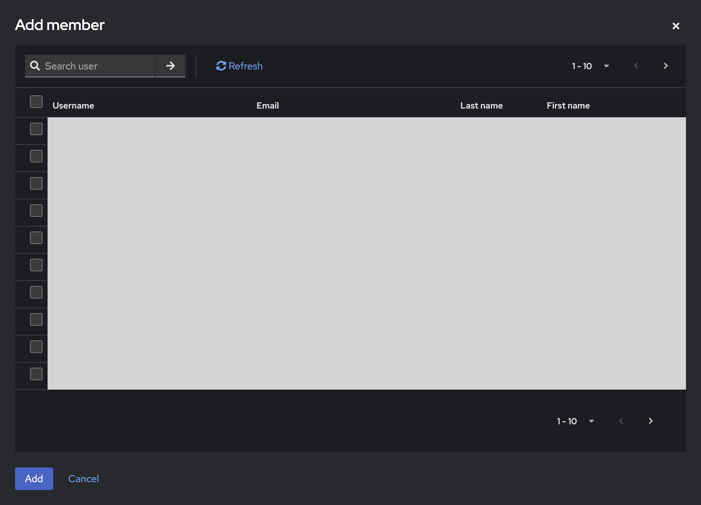

Project administrators can manage who belongs to their project group using the
[APEx security admin console](https://auth.apex.esa.int/admin/apex/console/).
You can manage only the groups for which you are a project administrator.

Adding someone to your project group gives them access to the project's private APEx tools and restricted portal pages.
Depending on your project environment, these can include [QGIS](../instantiation/app_qgis.md),
[JupyterLab](../instantiation/app_jupyterlab.md), [VS Code](../instantiation/app_code_server.md)
and restricted pages in the [Project Web Portal](../instantiation/project_portal.md).

## Before you begin

- You must already be a project administrator. Contact the APEx team if you need to be assigned this responsibility.
- Ask the person you want to add to [create an APEx account](./account.md) first.
  Confirm which account they use so you can select the right person.

## Open your project group

1. Open the [APEx security admin console](https://auth.apex.esa.int/admin/apex/console/)
   and sign in with your APEx account.
2. Select **Groups**. You will see the groups for which you are an administrator.
3. Select the group for your project.

    

4. In the **Child groups** tab, select **Roles**.
5. Select **Project Members** to manage access to the project's private tools and restricted portal pages.
    Do not select **Project Admins** to add an ordinary project member.

    

If your project group is missing, check that you have signed in with the correct account.
Contact the APEx team if you still cannot find it.

## Add a project member

1. In **Project Members**, select the **Members** tab.
2. Click **Add member**.

    

3. In the **Add member** window, enter the person's name, username or email address in **Search user**
    and click the search button.
4. Check the account details, then select the checkbox beside the person you want to add.
5. Click **Add**, then check that the person appears in the group's member list.

    

If you cannot find the person, ask them to complete the [APEx account creation steps](./account.md)
and confirm the account details they used before searching again.

The new member can now access the private tools and restricted portal pages available to your project group.
Share the relevant [project environment links](../instantiation/accessibility.md) with them.
They should sign in with the same APEx account you added to the group.

## Remove a project member

When someone no longer needs access, open **Groups**, select your project, then **Roles** and **Project Members**.
Open the **Members** tab.
Select the person to remove, choose the option to remove their membership, and confirm.
Check that they no longer appear in the group's member list.

This removes their membership of this project group; it does not delete their APEx account.

## Change project administrators

::: {.callout-warning}

## Administrator changes in the console are temporary

The **Project Admins** group under **Roles** also lets you change who administers the project, but these changes are temporary.
APEx manages project administrator assignments and automatically resets them to the configuration
maintained by the APEx team.

For a permanent change, contact the APEx team and provide the project name and the APEx account of the person
who should be added or removed as an administrator. The team must update the project configuration for the change to last.
:::
