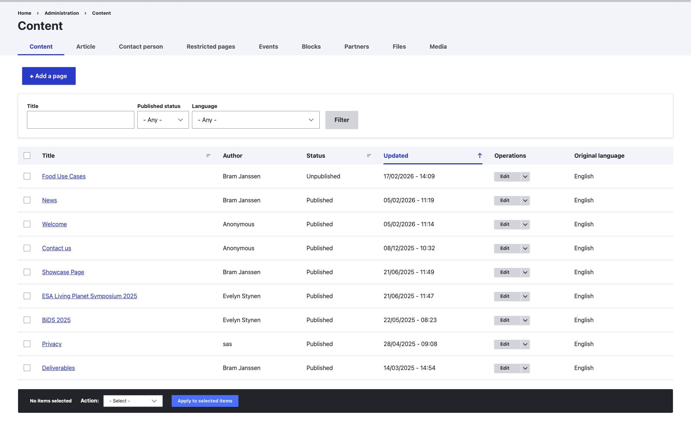
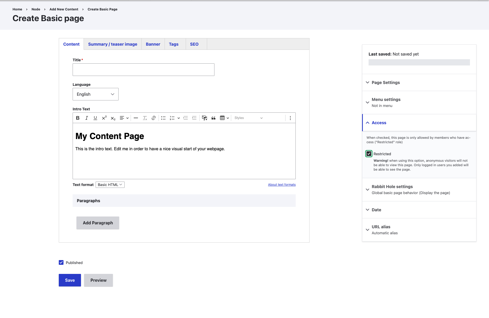

Use a restricted page for content that should not be publicly accessible on your project portal.
You need to be logged in with an account that can create and edit pages.
See [Log in](./1_login.qmd) to get started.

## Create a new page

1. Open **Content** in the navigation toolbar.
2. Choose **Add a page**, or select **Page** from the **Content** dropdown menu.
3. Enter a title and add the page content.

{group="gallery-restricted-page"}

For more details about the page editor, see [Manage web pages or add a new page](./2_create_page.qmd).

## Restrict access

1. In the settings sidebar on the right of the page editor, open **Access**.
2. Check **Restricted**.
3. Save the page with **Restricted** checked.

{group="gallery-restricted-page"}

The **Access** panel indicates that readers need the **Restricted** role. Being logged in alone is not sufficient.

Set the restriction before publishing the page so that its content is not made public first.
To restrict an existing page, open it for editing, change the same **Access** setting, and save your changes.

## Check access

After saving, verify that the restriction works as intended:

1. Open the page URL in a private browser window where you are not logged in.
   Confirm that the page content is not visible to anonymous visitors.
2. Check that an intended reader can access the page using their own account.
   If they cannot, ask your portal administrator to check their permissions.

Removing a page from a menu does not restrict access to its URL. Use the **Restricted** setting to control access.

::: {.callout-warning}

## Check linked files separately

Do not assume that restricting a page also protects files or external resources linked from it.
Check access to each linked resource before using the page to share confidential material.
:::
